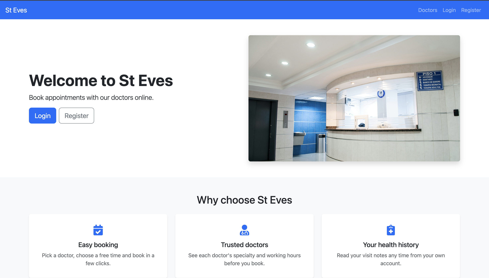
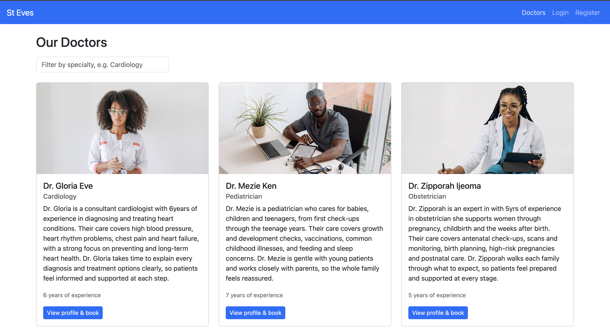
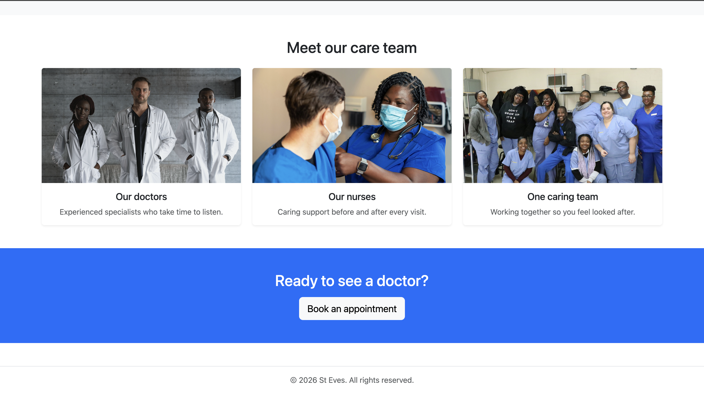
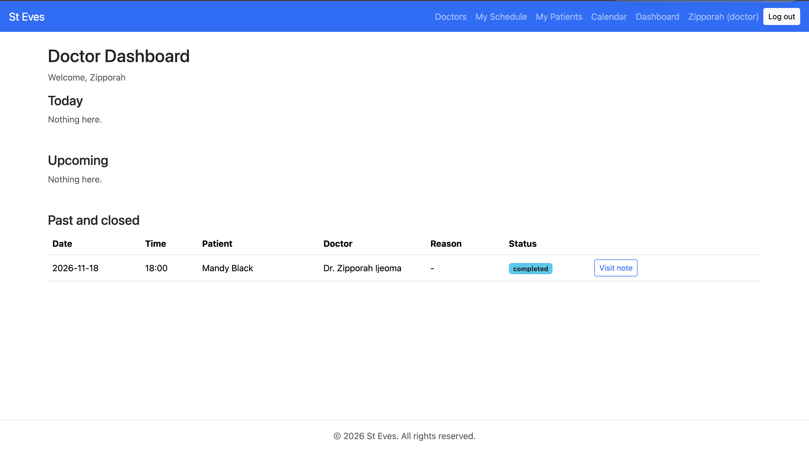
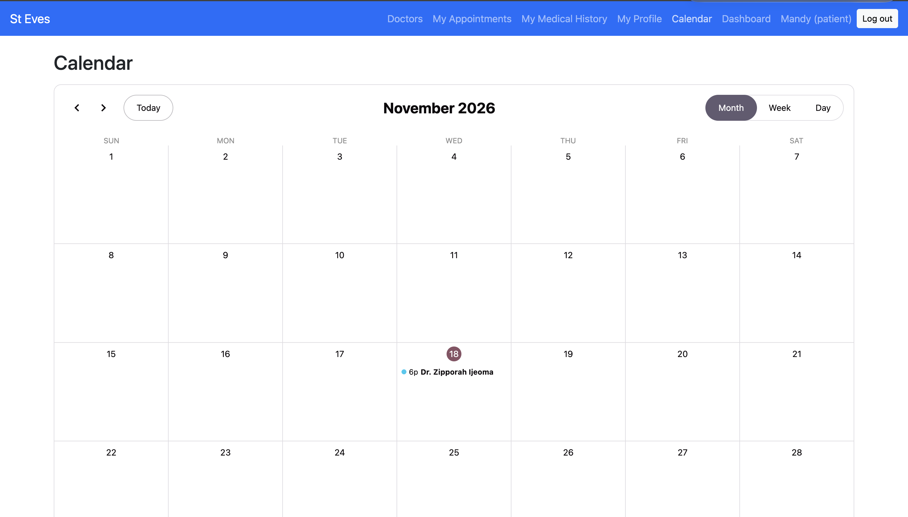

# St Eves Appointment Booking (Frontend)

The website for **St Eves**, a medical appointment booking system. Patients find a doctor and book a time, doctors manage their day, and staff help run the clinic.

This project is the website only. The server and database are in a separate project: [st-eves-api](https://github.com/eve-beep-ij/st-eves-api).

## Screenshots











## What you can do

**Everyone**
- Read about the clinic on the home page
- Browse the list of doctors and filter them by specialty
- See a doctor's profile and working hours
- Register and log in

**Patients**
- Book an appointment by choosing a doctor and a free time
- See their appointments grouped into Today, Upcoming and Past
- Cancel or reschedule an appointment
- Join a video call for a confirmed appointment
- Read their visit notes and download prescriptions as a PDF
- View and edit their profile
- See their appointments on a calendar

**Doctors**
- A dashboard with Today, Upcoming and Past appointments
- Confirm, cancel or complete appointments
- Set and manage their working days and hours
- Write visit notes and prescriptions
- See their list of patients and each patient's details
- Start a video call with a patient
- See their appointments on a calendar

**Staff**
- Help manage appointments, without access to medical notes or video calls

Each role only sees the pages it is allowed to see. Anyone else gets an "Access denied" page.

## Built with

- React (made with Vite)
- React Router
- Bootstrap
- React Icons
- FullCalendar (the calendar view)
- jsPDF (prescription PDFs)
- Axios (talks to the backend)
- Jitsi Meet (video calls)

## How to run it on your computer

You need Node.js installed. The backend from [st-eves-api](https://github.com/eve-beep-ij/st-eves-api) should also be running, or the website will have no data.

**1. Download the project**

```
git clone https://github.com/eve-beep-ij/st-eves-frontend.git
cd st-eves-frontend
```

**2. Install the packages**

```
npm install
```

**3. Check the backend address**

Open `src/api.js`. The backend address is set there as `http://127.0.0.1:8000/api`, which is where Django runs on your own computer. If your backend runs somewhere else, change it.

**4. Start the website**

```
npm run dev
```

Then open the link shown in the terminal, usually `http://localhost:5173`.

## Project structure

| Folder or file | What it holds |
| --- | --- |
| `src/pages/Public` | Home, doctors list, doctor profile, login, register |
| `src/pages/Patient` | Patient dashboard, appointments, history, profile, reschedule |
| `src/pages/Doctor` | Doctor dashboard, schedule, patients, appointment details |
| `src/pages/Extras` | Prescription and video call pages |
| `src/components` | Navbar, footer, calendar, protected routes |
| `src/context` | Login state shared across the app |
| `src/utils` | Helpers, such as the prescription PDF maker |
| `src/api.js` | Talks to the backend |

## Author

**Gloria Eve**, full-stack developer.